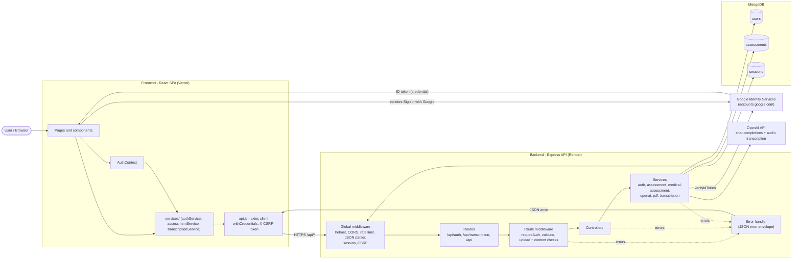
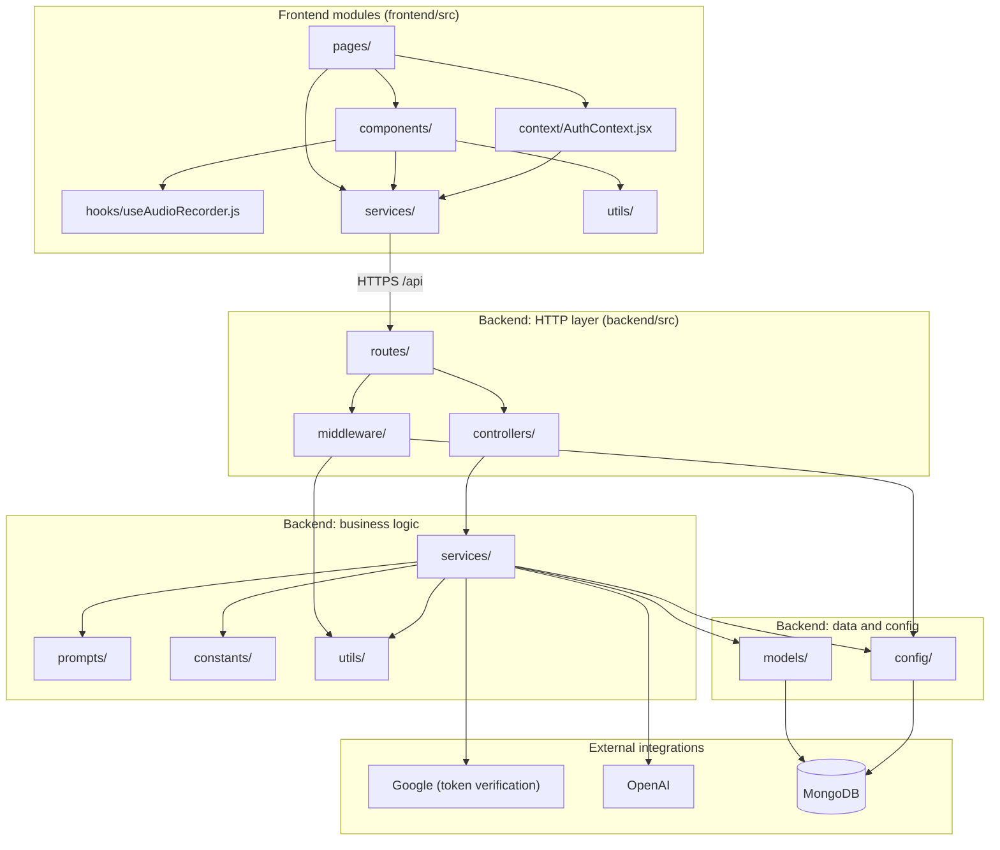
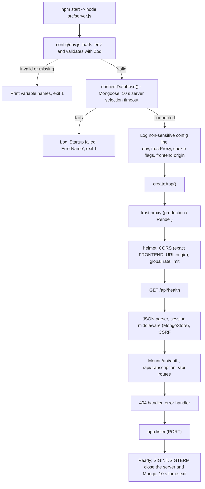
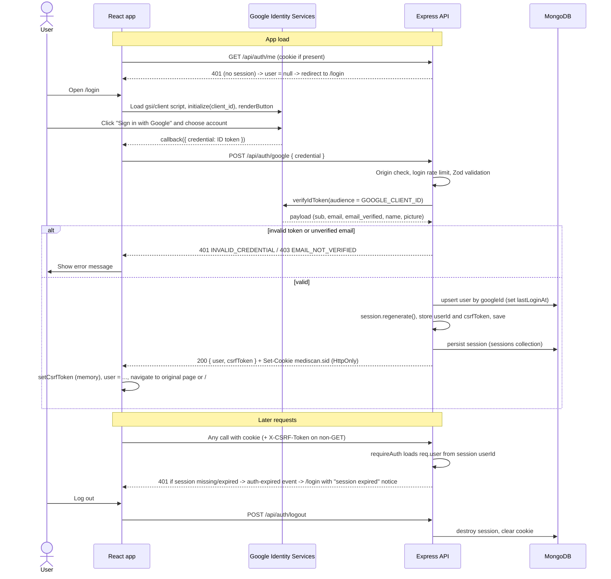
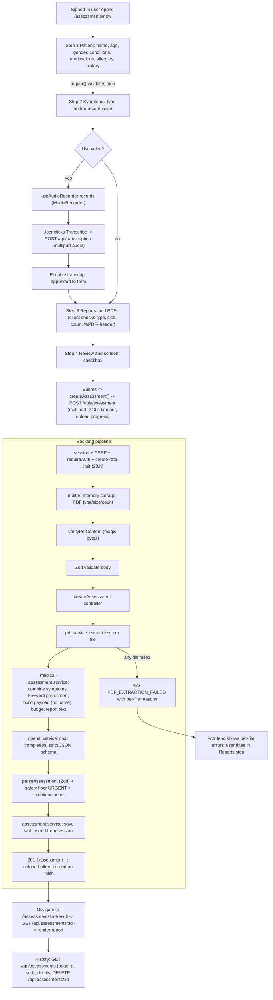
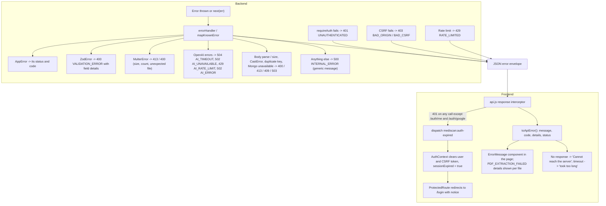
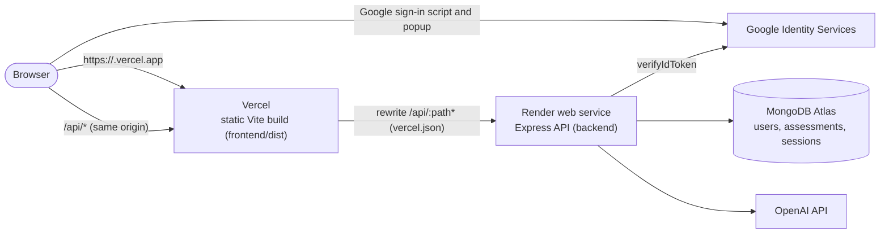

# MediScan AI

AI-powered **preliminary** medical assessment and medical-report interpretation. Users sign in with Google, enter patient details, describe symptoms by typing or by voice, upload PDF reports, and receive a structured AI assessment (urgency, possible conditions, report findings, recommendations, medication information, specialist suggestion). Assessments are saved to a per-user history.

> MediScan AI never provides a confirmed diagnosis and does not replace a healthcare professional.

JavaScript only (no TypeScript). React + Vite + Tailwind on the front end; Node.js + Express + MongoDB on the back end.

## Contents

1. [Features](#features)
2. [Technology stack](#technology-stack)
3. [Project structure](#project-structure)
4. [Overall application architecture](#overall-application-architecture)
5. [Module architecture](#module-architecture)
6. [Module responsibilities](#module-responsibilities)
7. [Application startup flow](#application-startup-flow)
8. [Authentication flow](#authentication-flow)
9. [Main application workflow](#main-application-workflow)
10. [API request flow](#api-request-flow)
11. [Error handling](#error-handling)
12. [Deployment architecture](#deployment-architecture)
13. [Environment configuration](#environment-configuration)
14. [Installation and setup](#installation-and-setup)
15. [Running the application](#running-the-application)
16. [API documentation](#api-documentation)
17. [Feature notes](#feature-notes)
18. [Security and privacy](#security-and-privacy)
19. [Troubleshooting](#troubleshooting)
20. [Future improvements](#future-improvements)

## Features

- Google sign-in (Google Identity Services); the ID token is verified on the server.
- 4-step assessment form: patient details, symptoms (typed and/or voice), PDF reports, review and consent.
- Voice recording in the browser (MediaRecorder) with server-side transcription; the transcript is editable before submission.
- PDF report upload (text-based PDFs) with text extraction.
- Structured AI assessment with urgency level, conditions, report findings, recommendations, medication information, specialist suggestion and follow-up questions.
- Emergency safety net: a keyword pre-screen guarantees at least `URGENT` for serious symptom keywords; `EMERGENCY` results show a full-width alert.
- Saved history: paginated, searchable by patient name, sortable; view and delete.
- Profile and local UI settings pages.

## Technology stack

| Layer | Technology |
|---|---|
| Frontend | React 19, Vite 6, Tailwind CSS 4, react-router-dom 7, axios, react-hook-form, lucide-react |
| Backend | Node.js 20+, Express 4 (ES modules), Mongoose 9, express-session + connect-mongo, helmet, cors, express-rate-limit, multer (memory storage), zod |
| Database | MongoDB (collections: `users`, `assessments`, `sessions`) |
| External services | Google Identity Services + `google-auth-library` (token verification), OpenAI API (chat completions with JSON-schema output, audio transcription) |
| PDF parsing | `pdf-parse` (text extraction only) |
| Hosting (configured in repo) | Vercel for the frontend (`frontend/vercel.json`), Render for the API (see [Deployment architecture](#deployment-architecture)) |

## Project structure

```
backend/
  scripts/build.js            syntax-checks every file in src/ (npm run build)
  test/core.test.js           unit tests (node --test)
  src/
    server.js                 entry point: DB connect -> create app -> listen -> graceful shutdown
    app.js                    Express app + middleware order
    config/                   env.js (validated env), database.js, session.js, openai.js
    routes/                   auth.routes.js, assessment.routes.js, transcription.routes.js
    controllers/              auth.controller.js, assessment.controller.js, transcription.controller.js
    services/                 auth, assessment, medical-assessment, openai, pdf, transcription
    middleware/               auth, csrf, validation, upload, error
    models/                   user.model.js, assessment.model.js
    prompts/                  medical-assessment.prompt.js (system prompt + JSON schema)
    constants/                medical.constants.js (limits, disclaimer, emergency patterns)
    utils/                    validators.js (Zod schemas, magic-byte checks), response-parser.js, file-cleanup.js
frontend/
  vercel.json                 /api proxy to the backend + SPA fallback
  src/
    main.jsx, App.jsx         bootstrap + route table
    context/AuthContext.jsx   auth state
    services/                 api.js (axios), authService, assessmentService, transcriptionService
    pages/                    Login, Dashboard, NewAssessment, AssessmentResult, AssessmentHistory,
                              AssessmentDetails, Profile, Settings
    components/               layout, form steps, voice recorder, PDF uploader, result cards
    hooks/useAudioRecorder.js
    utils/                    validation, formatting, settings (localStorage UI preferences only)
```

## Overall application architecture



Frontend and backend are separate deployables. They talk only over HTTPS JSON/multipart requests under `/api`, authenticated by an HttpOnly session cookie plus a CSRF header.

## Module architecture



## Module responsibilities

| Module | Location | Responsibility | Dependencies |
|---|---|---|---|
| App bootstrap | `frontend/src/main.jsx`, `App.jsx` | Mounts React with `BrowserRouter` and `AuthProvider`; declares routes (`/login` public; everything else inside `ProtectedRoute` + `AppLayout`) | AuthContext, pages |
| Auth state | `frontend/src/context/AuthContext.jsx`, `components/ProtectedRoute.jsx` | Calls `/auth/me` on start, exposes `user`, `login`, `logout`, `sessionExpired`; redirects unauthenticated users to `/login`; reacts to the `mediscan:auth-expired` event | authService, api.js |
| Google login button | `frontend/src/components/GoogleLoginButton.jsx` | Loads the Google Identity Services script, renders the button, passes the returned credential to `login()` | AuthContext, `VITE_GOOGLE_CLIENT_ID` |
| API client | `frontend/src/services/api.js` | axios instance (`VITE_API_URL`), `withCredentials`, in-memory CSRF token added as `X-CSRF-Token` on non-GET requests, 401 handling, `toApiError()` | axios |
| Frontend services | `frontend/src/services/authService.js`, `assessmentService.js`, `transcriptionService.js` | One function per endpoint (login, me, logout, create/list/get/delete assessment, upload limits, transcribe) | api.js |
| Assessment form | `frontend/src/pages/NewAssessment.jsx` + `PatientForm`, `SymptomInput`, `PDFUploader`, `AssessmentReview` | 4-step react-hook-form wizard; client-side validation; builds multipart request; navigates to the result page | assessmentService, utils/validation |
| Voice input | `components/VoiceRecorder.jsx`, `TranscriptionEditor.jsx`, `hooks/useAudioRecorder.js` | Records audio on-device, sends it to `/transcription` only when the user asks, appends the editable transcript to the symptoms | transcriptionService |
| Result and history pages | `pages/AssessmentResult`, `AssessmentHistory`, `AssessmentDetails`, `Dashboard`, `components/*Card`, `AssessmentReport` | Fetch and render stored assessments; search, sort, paginate, delete | assessmentService |
| Profile / Settings | `pages/Profile.jsx`, `Settings.jsx`, `utils/settings.js` | Show Google profile; UI preferences (page size, confirm-delete) kept in localStorage (non-sensitive) | AuthContext |
| Server entry | `backend/src/server.js` | Connects MongoDB, logs non-sensitive config, starts the HTTP server, handles SIGINT/SIGTERM | config/database, app.js |
| App factory | `backend/src/app.js` | Wires helmet, CORS, rate limit, JSON parser, session, CSRF, routes, 404 and error handlers | config, middleware, routes |
| Config | `backend/src/config/` | `env.js` validates env with Zod and exits on problems; `database.js` Mongoose connection; `session.js` express-session with MongoDB store; `openai.js` OpenAI client | zod, mongoose, connect-mongo, openai |
| Routes | `backend/src/routes/` | Map URLs to middleware chains and controllers; per-route rate limiters | middleware, controllers |
| Middleware | `backend/src/middleware/` | `auth` (session to `req.user`), `csrf` (Origin + token), `validation` (Zod), `upload` (multer in memory + magic-byte checks), `error` (AppError, error mapping) | models, utils, config |
| Controllers | `backend/src/controllers/` | Thin request handlers: orchestrate services and shape responses | services |
| Auth service | `services/auth.service.js` | Verifies the Google ID token (signature, audience, expiry, `email_verified`); upserts the user | google-auth-library, User model |
| PDF service | `services/pdf.service.js` | Extracts text from PDFs (30 s timeout, page cap); rejects scanned/unreadable PDFs by filename; OCR extension hook | pdf-parse |
| Medical-assessment service | `services/medical-assessment.service.js` | Combines typed and voice symptoms, runs the emergency keyword pre-screen, builds the JSON payload (no patient name), calls OpenAI, validates, applies the urgency floor | openai.service, prompts, constants, response-parser |
| OpenAI service | `services/openai.service.js` | Structured-output chat completion and audio transcription | config/openai |
| Transcription service | `services/transcription.service.js` | Wraps transcription, sanitises text, rejects empty speech | openai.service |
| Assessment service | `services/assessment.service.js` | CRUD on assessments, always filtered by session `userId`; DTO omits extracted report text | Assessment model |
| Prompts and constants | `backend/src/prompts/`, `constants/` | System prompt, strict JSON schema, disclaimer, emergency patterns, limits | - |
| Utils | `backend/src/utils/` | Zod input schemas, magic-byte checks, regex escaping, AI response parser/normaliser, buffer scrubbing | zod |
| Models | `backend/src/models/` | `User` (googleId, email, name, picture, lastLoginAt) and `Assessment` (patient data, report metadata, extracted text `select:false`, `aiAssessment`, `urgencyLevel`, consent) | mongoose |

## Application startup flow



The frontend starts separately: `main.jsx` renders `AuthProvider`, which immediately calls `GET /api/auth/me` to restore any existing session (see below).

## Authentication flow

Implemented as Google ID-token verification on the server followed by a cookie-based server session (no JWT, nothing auth-related in localStorage).



Cookie flags come from `config/session.js`: `HttpOnly`, `Secure` in production (or when `SameSite=None`), `SameSite=None` in production by default and `Lax` in development, absolute lifetime `SESSION_MAX_AGE`, no rolling extension.

## Main application workflow

The primary task: create an assessment and read the result.



## API request flow

Typical authenticated request (example: `POST /api/assessment`):

```mermaid
flowchart LR
  C["Component/page"] --> SV["services/assessmentService.js"]
  SV --> AX["api.js interceptor:<br/>add X-CSRF-Token, send cookie"]
  AX -->|"HTTPS /api/..."| PX["Vercel rewrite -> Render (production)"]
  PX --> H["helmet, CORS, rate limit"]
  H --> J["express.json"]
  J --> SE["express-session (load session from MongoDB)"]
  SE --> CS["csrfProtection<br/>(Origin + token on non-GET)"]
  CS --> RT["Router"]
  RT --> RA["requireAuth (loads req.user)"]
  RA --> RM["route middleware:<br/>rate limit, upload, content check, Zod validate"]
  RM --> CT["Controller"]
  CT --> SR["Service(s)"]
  SR --> D[("MongoDB / OpenAI / Google")]
  D --> SR --> CT -->|"res.json({ success, ... })"| AX
  AX --> SV --> C
```



## Error handling

Backend errors are normalised by `middleware/error.middleware.js` into `{ success:false, code, message, details? }`. Stack traces and submitted values are never returned or logged; only 5xx responses are logged, with method, path, status, code and error name.



Client-side validation (react-hook-form rules in `utils/validation.js`, PDF checks in `PDFUploader`) runs before any request is sent.

## Deployment architecture

Deployment settings found in the repo: `frontend/vercel.json` (Vercel) and the production defaults in `backend/src/config/env.js` and `config/session.js`. The API host (Render) is configured in the Render dashboard; the repo contains no Render blueprint.



Why the proxy: `*.vercel.app` and `*.onrender.com` are different sites, so a cookie set directly by the API is third-party and often blocked. With `VITE_API_URL=/api` the browser only talks to the Vercel origin, and Vercel forwards `/api/*` to Render, so the session cookie is first-party. The `/(.*)` rewrite serves `index.html` for client-side routes.

Production environment variables:

| Where | Variable | Value |
|---|---|---|
| Vercel (project root directory `frontend`) | `VITE_API_URL` | `/api` |
| Vercel | `VITE_GOOGLE_CLIENT_ID` | Google OAuth Web client ID (no quotes) |
| Render | `NODE_ENV` | `production` |
| Render | `FRONTEND_URL` | exact frontend origin, e.g. `https://<app>.vercel.app` (no trailing slash) |
| Render | `GOOGLE_CLIENT_ID`, `MONGODB_URI`, `OPENAI_API_KEY`, `OPENAI_MODEL`, `OPENAI_TRANSCRIPTION_MODEL`, `SESSION_SECRET` | see below |

Vite embeds `VITE_*` values at build time, so redeploy the frontend after changing them. Also add the frontend origin under *Authorized JavaScript origins* for the Google client, and allow Render's outbound IPs in MongoDB Atlas network access.

## Environment configuration

Backend (`backend/.env`, validated at startup by `src/config/env.js`; the server exits listing anything missing):

| Variable | Required | Notes |
|---|---|---|
| `MONGODB_URI` | yes | MongoDB connection string |
| `OPENAI_API_KEY` | yes | server-side only |
| `OPENAI_MODEL` | yes | chat model supporting structured outputs |
| `OPENAI_TRANSCRIPTION_MODEL` | yes | speech-to-text model |
| `GOOGLE_CLIENT_ID` | yes | same value as the frontend ID; no client secret is used |
| `SESSION_SECRET` | yes | at least 16 characters |
| `FRONTEND_URL` | no (default `http://localhost:5173`) | exact allowed origin for CORS and the CSRF Origin check |
| `PORT` | no (5000) | |
| `NODE_ENV` | no (`development`) | `production` enables Secure cookies, `SameSite=None` and trust proxy |
| `MAX_FILE_SIZE`, `MAX_FILES`, `SESSION_MAX_AGE` | no | bytes per PDF (10 MB), PDFs per assessment (5), session lifetime in ms (8 h) |
| `MAX_AUDIO_SIZE`, `MAX_PDF_PAGES`, `OPENAI_TIMEOUT_MS` | no | 25 MB, 60 pages, 90 000 ms |
| `COOKIE_SAMESITE` | no | `lax`/`strict`/`none`; default `none` in production, `lax` otherwise |
| `TRUST_PROXY` | no | `true`/`false`; default on in production or when `RENDER` is set |

Frontend (`frontend/.env`): `VITE_API_URL` (default `http://localhost:5000/api`) and `VITE_GOOGLE_CLIENT_ID`.

Model names are never hard-coded; they come only from env. `.env` files are gitignored; use `backend/.env.example` as a template.

## Installation and setup

Prerequisites: Node.js 20.19+ recommended (20.x works; Vite 6 is pinned for older 20.x), MongoDB 6+ (local or Atlas), a Google Cloud OAuth Web client ID, and an OpenAI API key.

### 1. MongoDB
Local: install MongoDB Community and use `mongodb://127.0.0.1:27017/mediscan`. Atlas: create a free cluster, add your IP to the access list, and copy the connection string.

### 2. Google OAuth
1. Open <https://console.cloud.google.com> and create/select a project.
2. **APIs & Services → OAuth consent screen**: choose External, set app name, support email, and authorized domains (production domain; not needed for localhost). Add test users while in "Testing" mode.
3. **Credentials → Create credentials → OAuth client ID → Web application**.
4. **Authorized JavaScript origins**: `http://localhost:5173` (dev) and your production origin, e.g. `https://app.example.com`. No redirect URI is needed (Google Identity Services credential flow).
5. Copy the **Client ID** into `GOOGLE_CLIENT_ID` (backend) and `VITE_GOOGLE_CLIENT_ID` (frontend). No client secret is used.

### 3. Backend
```bash
cd backend
npm install
cp .env.example .env     # fill in values
```

### 4. Frontend
```bash
cd frontend
npm install
cp .env.example .env     # set VITE_GOOGLE_CLIENT_ID (and VITE_API_URL if not default)
```

## Running the application

```bash
# backend (http://localhost:5000)
cd backend
npm run dev          # watch mode
npm start            # plain start
npm run build        # syntax-check all source files
npm test             # unit tests

# frontend (http://localhost:5173)
cd frontend
npm run dev
npm run build        # production build in dist/
```

## API documentation

| Method | Path | Auth | Description |
|---|---|---|---|
| GET | `/api/health` | - | Status + upload limits |
| POST | `/api/auth/google` | - | `{credential}` → verify, upsert user, create session; returns `{user, csrfToken}` |
| GET | `/api/auth/me` | ✔ | Current user (+ CSRF token) |
| POST | `/api/auth/logout` | ✔ | Destroy session, clear cookie |
| POST | `/api/transcription` | ✔ | multipart `audio` → `{transcription}` (60/hour per client) |
| POST | `/api/assessment` | ✔ | multipart: patient fields + `reports` (PDFs) → structured assessment (20/hour per client) |
| GET | `/api/assessments?page&limit&q&sort` | ✔ | Paginated, searchable (patient name), sortable history |
| GET | `/api/assessments/:id` | ✔ | One assessment (ownership enforced) |
| DELETE | `/api/assessments/:id` | ✔ | Delete (ownership enforced) |

All non-GET requests except `/api/auth/google` need the `X-CSRF-Token` header. Errors: `{ success:false, code, message, details? }`.

## Feature notes

- **Voice:** MediaRecorder (webm/opus, mp4 or ogg depending on browser), pause/resume where supported, playback, delete, re-record. Audio stays on the device until the user presses *Transcribe recording*. The transcription is appended to an editable text area; typed symptoms and the (edited) transcription are combined server-side without duplication.
- **PDFs:** client checks extension, MIME, size, count, and `%PDF-` header; server re-checks and parses text with `pdf-parse`. Unreadable or scanned PDFs are rejected **by filename** with an explanation – never silently skipped. `registerOcrProvider()` in `pdf.service.js` is the OCR extension point.
- **AI:** system prompt in `prompts/medical-assessment.prompt.js`; strict JSON-schema structured output; Zod validation (`utils/response-parser.js`); fixed disclaimer; medication items default to "requires professional confirmation".
- **Emergency safety:** keyword pre-screen raises any matching case to at least URGENT even if the model under-calls it (it cannot understand negation, so it errs on the side of caution); EMERGENCY results render a full-width alert as the first element of the page (112 for India).
- **Storage:** uploads use in-memory buffers (zeroed after the request). Only metadata and extracted text are stored; there are no public file URLs.

## Security and privacy

Helmet, locked-down CORS, global + per-route rate limits, Zod validation, magic-byte file validation, HttpOnly/SameSite/Secure cookies with absolute expiry, session regeneration on login, CSRF (Origin check + per-session token header), ownership-scoped queries (owner always from the session), regex-escaped search, API timeouts. Patient data is not logged, not placed in URLs, and the patient's name is not sent to OpenAI. PDF text and symptom text are passed only as JSON data with instructions in the system prompt to ignore embedded instructions. No analytics.

Consent: users must tick a consent box before submission; it is stored with each assessment (`consent.given/at/version`).

Review before real-world use: data-protection law (HIPAA/GDPR/DPDP), data-processing agreements with OpenAI/Google/hosting, retention policy, and clinical review of prompts. This software is not a certified medical device.

## Troubleshooting

- **Server exits at start:** read the listed missing env vars; check `MONGODB_URI` reachability (for Atlas, allow your IP / Render's IPs).
- **Google button missing / "origin not allowed":** add the exact frontend origin to *Authorized JavaScript origins*; confirm `VITE_GOOGLE_CLIENT_ID`; disable ad-blockers for `accounts.google.com`.
- **`Error 401: invalid_client` ("OAuth client was not found"):** the client ID in the build is missing, wrong or wrapped in quotes. Set `VITE_GOOGLE_CLIENT_ID` in the hosting dashboard (no quotes) and redeploy.
- **Login returns 200 but next calls are 401 (split hosting):** the session cookie isn't being set or sent. Needs `NODE_ENV=production` (or `TRUST_PROXY=true`), HTTPS, and `FRONTEND_URL` equal to the exact frontend origin. Two different hosts (e.g. `*.vercel.app` and `*.onrender.com`) are *cross-site* and Safari/Firefox may block third-party cookies; use the same-origin proxy described in [Deployment architecture](#deployment-architecture).
- **Logged out immediately / 403 BAD_CSRF or BAD_ORIGIN:** `FRONTEND_URL` must exactly equal the browser origin (no trailing slash or path).
- **Microphone blocked:** microphone needs HTTPS or `localhost`, and browser permission.
- **"PDF may be scanned":** only text-based PDFs are supported until an OCR provider is registered.
- **OpenAI 400 about `json_schema`:** pick a model that supports structured outputs.
- **`vite` native-binding error:** use Node ≥ 20.19 or keep the pinned Vite 6.

## Future improvements

- OCR provider for scanned PDFs (hook already exists in `pdf.service.js`).
- Optional private object storage if original report files must be retained.
- Context-aware (negation-safe) emergency detection beyond the keyword floor.
- Integration and end-to-end tests (only unit tests exist today).
